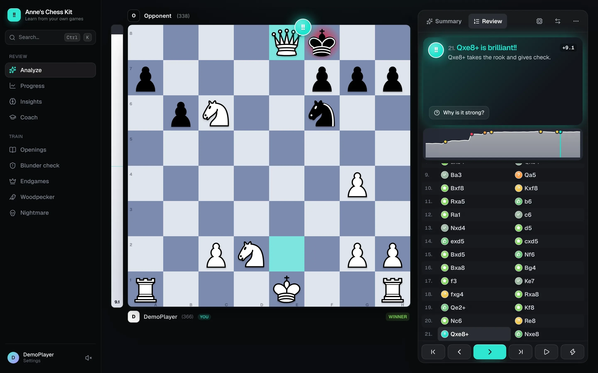
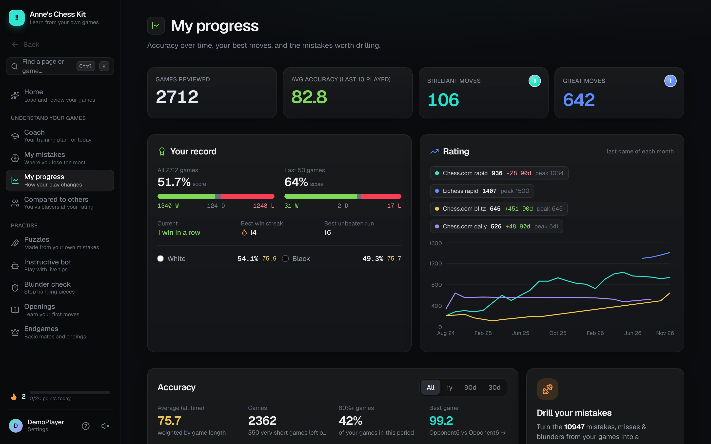
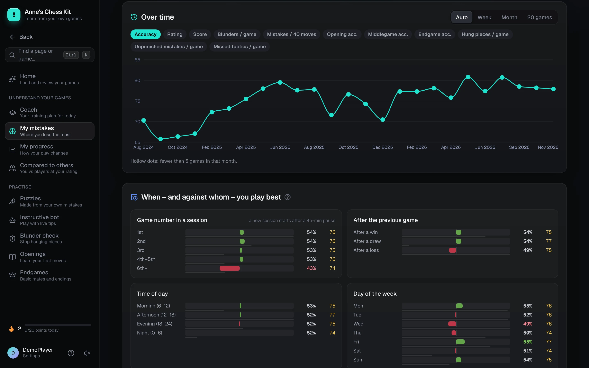
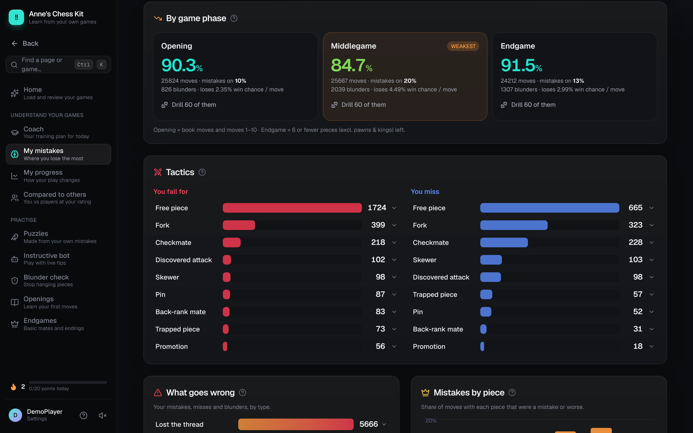
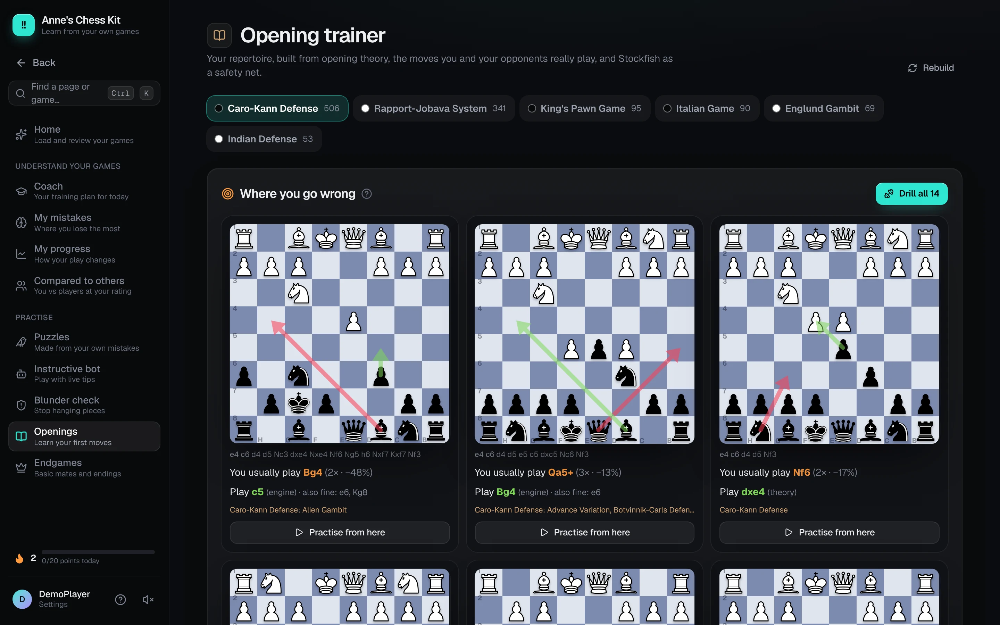

<p align="center">
  
</p>

<h1 align="center">Anne's Chess Kit</h1>

<p align="center">
  <b>Chess game review and training that runs entirely on your computer.</b><br>
  Free and open source. No account, no limits, no uploads.
</p>

<p align="center">
  <a href="../../releases/latest"></a>
  <a href="LICENSE"></a>
  
</p>

<p align="center">
  <a href="../../releases/latest"><b>Download for Windows</b></a> ·
  <a href="https://peptopekto.github.io/annes-chess-kit/">Project page</a> ·
  <a href="#features">Features</a> ·
  <a href="#getting-started">Getting started</a> ·
  <a href="#how-moves-are-rated">How moves are rated</a>
</p>

Import your games from Chess.com, Lichess or a PGN, and Stockfish rates every move – Brilliant, Great,
Best … Mistake, Miss, Blunder – with accuracy, plain-language coaching and the moves you should have played.
Then the kit turns your own mistakes into training: recurring habits, puzzle sets, a blunder-check trainer, an
opening trainer, an endgame trainer and a human-like opponent that plays for your weaknesses.

Your games and reviews stay on your machine.



<p align="center">
  
  
  
  
</p>

## Features

**Review**
- Move ratings, eval bar and clickable eval graph, accuracy per side.
- A coach card for every move: what it does, why a mistake was bad (the punishing reply as a red arrow, the
  tactic it allowed, what it costs), what was better – worded for whoever moved ("you" on your moves, "your
  opponent" on theirs).
- A principle card for positional mistakes: when the engine's lines confirm that a move created a weakness
  or gave something up (an isolated or backward pawn, a hole, an outpost, the open file, king safety, …),
  the card shows the lesson for it – the principle, why it holds, the question to ask yourself next time,
  when it doesn't apply, the book it comes from – marks the squares and plays through a model position
  (`P`). On your opponent's moves it says what their mistake gives you and shows the engine's way to use it.
  Nothing is shown for tactical or material mistakes. "Fits this move?" feedback makes lessons you
  reject rarer. The 36 lesson cards are plain YAML in `backend/data/coach/`.
- Retry your mistakes, play out the best line, explore your own lines, live engine lines (`E`).
- How the game ended (mate, stalemate, repetition, …), annotated PGN export, re-analysis.

**Your games**
- Import your whole Chess.com and Lichess history once (later visits fetch only new games) into one list,
  each game marked with its site; filter it and analyse any number of games in the background. Games against
  the Instructive bot have their own tab.
- **Progress**: record, rating over time, accuracy trends, personal records, activity calendar.
- **Insights**: where you lose points – by game phase, piece, clock, opening, tactic, time of day, opponent
  strength – each with a drill of exactly those positions.
- **Your level**: your stats next to your opponents' – the players at your rating, and those above and below
  it – measured the same way from your reviews (accuracy, errors by type and phase, punishing mistakes,
  converting wins, clock, opening habits, positional lessons). A difference only counts when it's clearly
  larger than the noise (two standard errors, games as the unit).
- **Coach**: the habits behind your mistakes ranked by what they cost you, mistakes you repeat move for move,
  warning signs, strengths and a training plan.

**Training**
- **Opening trainer** built from opening theory, your games and Stockfish.
- **Blunder check**: "is this move safe?" on your own blunders mixed with sound moves.
- **Woodpecker** puzzle cycles, from your mistakes or the Lichess puzzle database.
- **Endgames**: the basic mates, king-and-pawn endings, Lucena, Philidor, queen vs pawn and more – against
  perfect defence or a human-like defender.
- **Calculation mode** for puzzles: enter the whole line before any move is played – the way puzzles are
  solved over the board, in your head.
- **Instructive bot**: a human-like opponent (Maia) at the strength you choose, with live coaching – each of
  your moves is rated on the spot (quick Stockfish search) and marked on the board like in a review, with the
  better move after a mistake. Nightmare mode makes it steer into your weak openings and set the tactics you
  fall for. Optional: opening variety, and gambits to practise against (Alien, Englund, Smith-Morra, Budapest,
  … – 28 lines in `backend/data/gambits.yaml`), played whenever your moves allow it. Premoves work like on
  the big sites.
  Every game earns XP (more against a stronger bot) towards levels and achievements, your moves feed a
  statistics page (accuracy, good and bad moves, score per bot strength) and your Brilliant and Great moves go
  into a collection – a benchmark you can reset.

Everything works with the keyboard and the mouse wheel; `Ctrl/⌘ + K` opens the command palette.

## Getting started

### Windows: download and start (easiest)

From the [Releases](../../releases) page, take one of the two downloads. Both come with everything
the app needs – their own Python, Stockfish, and Lc0 with the Maia networks for the Instructive bot –
so there is nothing else to install:

- **`AnnesChessKit-X.Y.Z-setup.exe`** – the installer. Installs for your user only (no administrator rights),
  adds a Start-menu entry and, if you like, a desktop shortcut. Installing a newer version over it keeps
  your data.
- **`AnnesChessKit-X.Y.Z-windows.zip`** – the portable version. Unpack it anywhere (a USB stick works) and
  double-click `AnnesChessKit.exe` in the folder.

The app opens in its own window; closing the window quits it. Then open **Settings** and enter your
Chess.com and/or Lichess username, so the statistics focus on *your* moves.

Good to know:

- Windows may show "Windows protected your PC" on the first start, because the download isn't signed:
  choose **More info → Run anyway**.
- Your reviews, settings and progress are in the `userdata` folder inside the program folder. To move
  to another PC, copy that folder; to back up, copy it.
- `AnnesChessKit.exe` only starts the app – it needs the folder around it. Make a shortcut to it rather than
  moving it out.

### macOS / Linux, or without the downloads

You need **Python 3.11+** and **[Stockfish](https://stockfishchess.org/download/)** (free) – see
"From source" below; start it with `./annes-chess-kit.sh` and stop it with `Ctrl+C`.

### From source

```bash
git clone https://github.com/peptopekto/annes-chess-kit.git && cd annes-chess-kit
cd frontend && npm ci && npm run build && cd ..   # build the UI once (Node.js 20.19+ or 22+)
# put Stockfish into engine/ – see engine/README.md
./annes-chess-kit.sh                              # Windows: AnnesChessKit.bat
```

`run.py` options: `--port 8800`, `--browser` (a normal browser tab instead of an app window), `--no-open`,
`--keep-running` (don't quit when the window closes). On Windows, `AnnesChessKit (debug).bat` starts it with
a console and `scripts/launcher/build.bat` builds `AnnesChessKit.exe` (it uses the C# compiler that comes with Windows).

### Building the Windows downloads yourself

`package.bat` builds the ready-to-run folder `dist\AnnesChessKit` and `dist\AnnesChessKit-X.Y.Z-windows.zip` on
your own PC (it downloads Python and the packages; the engines are copied from your `engine` folder).
`package.bat -Engines download` fetches Stockfish, Lc0 and the Maia networks instead, and
`package.bat -Installer` also builds the setup program (needs the free [Inno Setup](https://jrsoftware.org/isdl.php)).
`package.bat -EngineSources` also packs the source code of the included engine versions into
`dist\AnnesChessKit-X.Y.Z-engine-sources.zip`. Every build carries the licences of what it includes
(`licenses\`, `engine\ENGINES.txt`). Pushing a tag like `v1.2.0` makes GitHub build all of it and attach it to
a release (`.github/workflows/release.yml`); the tag has to match `__version__` in `backend/app/__init__.py`.

### Optional extras

| Add | Unlocks |
|---|---|
| [Lc0](https://github.com/LeelaChessZero/lc0/releases) + the [Maia networks](https://github.com/CSSLab/maia-chess/tree/master/maia_weights) in `engine/` | Instructive bot (Nightmare), human opponents in Endgames |
| [Syzygy tablebases](https://syzygy-tables.info) in `engine/syzygy/` | exact play in the Endgames trainer |
| The [Lichess puzzle database](https://database.lichess.org/#puzzles), unpacked (path in Settings) | Woodpecker sets from Lichess puzzles |

Details in [engine/README.md](engine/README.md).

## Analysis settings

Settings → Analysis (or the picker next to *Analyze*):

- **Fixed depth** (8–30, default 16) – identical results on every run. 12 is quick, 20+ is thorough.
- **Fixed time per move** (0.5–5 s, up to a depth limit) – a faster PC searches deeper in the same time.
- **CPU use** – how many engines analyse at once (automatic: all hardware threads but two). It applies
  immediately, so you can keep your PC responsive during a big batch.

Each review records how it was searched ("depth 16", "1 s per move · avg depth 23"). Changing the settings
doesn't redo existing reviews; *Re-analyze deeper* on a review does.

The app runs one single-threaded engine per thread, each working through consecutive positions so its hash
carries over – several times faster than one multi-threaded engine at the same depth (≈40 positions/s at
depth 16 on an 8-core desktop CPU).

## How moves are rated

Everything is measured in *expected points* (win probability) lost compared with Stockfish's best move – see
`backend/app/classify.py`. The win-probability curve is **rating-aware**: in a 1000-rated game a +2 position
is far from won, so the curve is flatter for lower ratings (fitted on real results; Chess.com ratings are
shifted +350 to the Lichess scale). The played move is searched from the same position and depth as the best
move, so a game gets identical ratings every time it's analysed.

| Rating | Rule |
|---|---|
| Best | the engine's top move, or one just as good (loses < 0.5 %) |
| Excellent / Good | loses < 2 % / < 5 % (scaled by the curve) |
| Inaccuracy / Mistake / Blunder | loses < 10 % / < 20 % / ≥ 20 % (scaled by the curve). A move that allows a forced mate the best move avoided is always a Blunder, even in a lost position |
| **Brilliant** | a best or excellent move that really sacrifices a piece: in the engine's line you end up at least two pawns' worth down for more than one move, or the piece offered can't be taken without loss. Never a king move, and not when you were already winning anyway |
| **Great** | the only good move – the next-best move is clearly worse (not an obvious recapture) |
| **Miss** | you let a forced mate slip (a mate in 1–3 always counts, a longer one if you're still clearly winning), or you failed to punish your opponent's mistake – but only if your move didn't leave you worse off than before their mistake and didn't hang material; otherwise it's a Mistake or Blunder |
| Book | the position is in the Lichess opening book |
| Forced | the only legal move |

Brilliant and Great moves are double-checked with a deeper search (depth 22+); a move that doesn't hold up
there keeps the plain rating that search gives it.

Accuracy uses Lichess's formula (volatility-weighted and harmonic mean of per-move accuracy).

## Your data and privacy

The app only listens on `127.0.0.1`, so nothing on your network can reach it. It goes online only to fetch
games from the Chess.com and Lichess public APIs when you import them. Everything else – reviews, imported
games, settings, training records – is in the `userdata/` folder, which is never part of the repository.
Back it up or move it with the program; set `CHESSKIT_USERDATA` to keep it elsewhere.

## Development

See [CONTRIBUTING.md](CONTRIBUTING.md). In short:

```bash
python -m venv .venv && .venv/bin/pip install -r requirements-dev.txt
.venv/bin/python -m pytest backend            # tests (no engine needed)
cd frontend && npm ci && npm run dev          # UI with hot reload on :5173 (proxies /api to :8765)
```

```
backend/app/     FastAPI + python-chess: analysis, classification, coaching, insights, trainers
backend/tests/   pytest
frontend/        React + Vite + Tailwind, chessground board
engine/          engines and networks you download (not in the repository)
scripts/         Windows packaging, launcher, icon, licence collector
docs/            project page (GitHub Pages) and screenshots
run.py           starts the server and opens the app window
userdata/        your data (created on first start)
```

## License

Copyright © 2026 the Anne's Chess Kit contributors.

Anne's Chess Kit is free software under the [GNU General Public License v3.0 or later](LICENSE): you may use,
study, share and change it; if you distribute it (changed or not), you have to pass on the same freedoms and
the source code. It builds on python-chess, Stockfish, Lc0 and the Maia networks, chessground, the Lichess
opening book and more – see [THIRD_PARTY_NOTICES.md](THIRD_PARTY_NOTICES.md) for every component, its licence
and its source.

Anne's Chess Kit is an independent project. It is not affiliated with or endorsed by Chess.com, Lichess or
the Stockfish, Lc0 or Maia projects.
